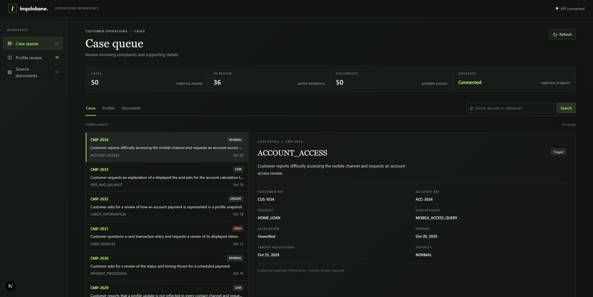
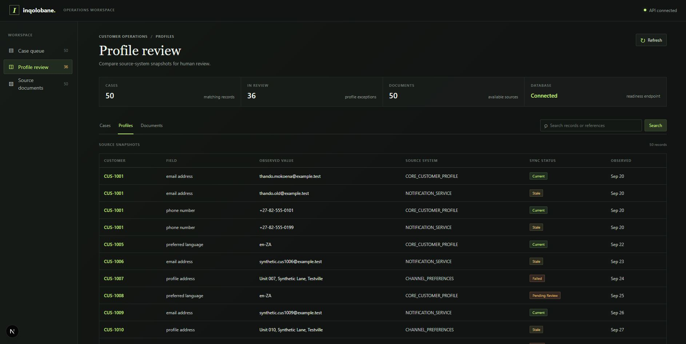
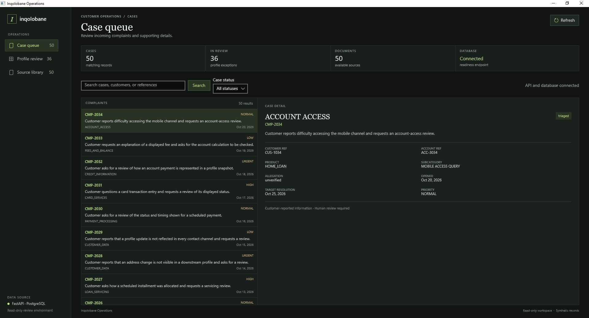
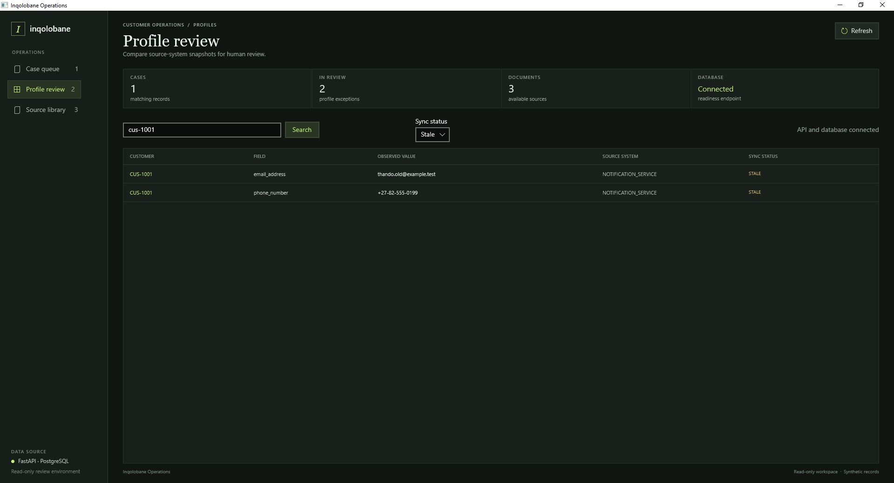

# Inqolobane

A local-first customer operations workbench for reviewing synthetic financial-services complaints and investigating data-integrity issues. The initial application provides a read-only case queue backed by FastAPI and PostgreSQL, with a Next.js and TypeScript operations interface.

> **Synthetic data only:** All customers, accounts, complaints, documents, and identifiers in this repository are fictional. Do not use this project to make real credit, fraud, collections, insurance, or customer-eligibility decisions.

## Project goals

The workbench is intended to help an authorised operations user:

- Find a case by complaint, customer, account reference, category, or summary.
- Review a concise case summary and its current operational status.
- Identify profile conflicts for human investigation without overwriting source records.
- Add evidence retrieval and agent-assisted workflows later, with citations and access controls.

The application is decision support, not an autonomous adjudicator. No agent, language model, vector search, transaction update, or case mutation is currently active.

### Web Dashboard Screenshots



### Windows Dashboard Screenshots



## Current implementation

| Area | Available now |
|---|---|
| Backend | Python 3.12+, FastAPI, Pydantic settings, SQLAlchemy, PostgreSQL driver |
| API | Read-only case queue, profile snapshots, local document catalog/search, and liveness/readiness checks |
| Frontend | Next.js App Router, TypeScript, responsive dark workbench with functional cases, profile review, and source-document views |
| Windows desktop | C# WinUI 3 operations client for cases, profile snapshots, source documents, search, status filters, and API/database readiness |
| Fixture loading | Idempotent local seed script for the supplied customers, accounts, complaints, and profile snapshots |
| AI and retrieval | Not active. Qdrant, SentenceTransformers, Ollama, Redis, and LangChain are reserved for a later retrieval/agent phase |
| Runtime | Local processes and services; no Docker containers are required |

The frontend reports API/database failures instead of filling the screen with invented case records. The case queue omits names, email addresses, phone numbers, and residential addresses. Profile review intentionally displays synthetic snapshot values for reconciliation. Complaint narratives remain customer-reported and are not presented as verified findings.

## Repository layout

```text
.
├── backend/
│   ├── pyproject.toml
│   ├── .env.example
│   ├── scripts/seed_local.py
│   ├── src/
│   │   ├── api/                 # Case, profile, document, and health routes
│   │   ├── config/              # Local runtime settings
│   │   ├── repositories/        # Case and profile database reads
│   │   ├── schemas/             # API contracts
│   │   ├── services/            # Document catalog and fixture-loading logic
│   │   ├── database.py
│   │   └── main.py              # FastAPI application entry point
│   └── tests/
├── desktop/
│   ├── Inqolobane.Desktop/      # C# WinUI 3 Windows application
│   └── SMOKE-TESTS.md           # Windows build and smoke-test instructions
├── frontend/                   # Next.js and TypeScript application
├── data/                        # Synthetic CSV fixtures and source documents
├── docs/                        # Data dictionary and evaluation plan
├── sql/schema.sql               # Database initialization file
├── CHANGE.md
└── README.md
```

## Local prerequisites

- Python 3.12 or newer
- Node.js 20.9 or newer and npm
- A local PostgreSQL instance
- A local database named `inqolobane` (or update `DATABASE_URL`)
- For the Windows desktop client: Windows 10 version 2004 (build 19041) or newer, .NET 10 SDK, Visual Studio's WinUI application development workload, and Windows App Runtime 2.5.1

PostgreSQL is the only service required to run the current case queue. The future retrieval/agent services are not needed yet. Keep all services on localhost; this project does not use Docker.

## Start the application

### 1. Configure PostgreSQL and the API

Create a local PostgreSQL database, then initialize it with the repository's SQL file. The file is referenced here for setup; SQL structure and query examples are intentionally not documented in this README.

```bash
cd backend
cp .env.example .env
```

Set `DATABASE_URL` in `backend/.env` to match your local PostgreSQL user, password, host, port, and database. Then install and start the API:

```bash
python -m venv .venv
source .venv/bin/activate
pip install -e ".[dev]"
psql -d inqolobane -f ../sql/schema.sql
python scripts/seed_local.py
uvicorn src.main:app --reload --host 127.0.0.1 --port 8000
```

The API listens at `http://localhost:8000`. Interactive API documentation is available at `http://localhost:8000/docs`.

### 2. Start the frontend

In a second terminal:

```bash
cd frontend
npm install
npm run dev -- --hostname 127.0.0.1
```

Open `http://localhost:3000`. The frontend uses `http://localhost:8000/api/v1` by default. Set `NEXT_PUBLIC_API_URL` in `frontend/.env.local` if the API is running at a different local URL. The API's default CORS origin is `http://localhost:3000`.

### 3. Build and start the Windows desktop app

The desktop client is a separate WinUI 3 application in `desktop/Inqolobane.Desktop`. It calls the same read-only FastAPI endpoints as the web frontend; it does not use a separate database connection. Start FastAPI first and confirm that its readiness endpoint is reachable from Windows.

Install the .NET 10 SDK and the Visual Studio **WinUI application development** workload on Windows. The unpackaged app also requires the Windows App Runtime 2.5.1. If the repository is under WSL, copy the `desktop/` directory to a Windows-local folder before building. For example, use `robocopy` from PowerShell with the WSL source path and Windows destination path for your machine; building directly from a WSL UNC path is not recommended.

From PowerShell, set the API URL to an address reachable from Windows, then build and run:

```powershell
$env:INQOLOBANE_API_URL = "http://localhost:8000/api/v1"
Set-Location "$HOME\source\inqolobane\desktop\Inqolobane.Desktop"
dotnet restore .\Inqolobane.Desktop.csproj
dotnet build .\Inqolobane.Desktop.csproj --configuration Debug -p:Platform=x64
dotnet run --project .\Inqolobane.Desktop.csproj --configuration Debug -p:Platform=x64
```

If FastAPI is hosted somewhere other than `localhost:8000`, set `INQOLOBANE_API_URL` to its reachable base URL ending in `/api/v1`. The app displays API/database status and reports request failures rather than substituting demo records. See [`desktop/SMOKE-TESTS.md`](desktop/SMOKE-TESTS.md) for endpoint checks, workflow verification, and startup-crash diagnostics.

## API endpoints

- `GET /api/v1/cases` lists cases. Optional query parameters: `search`, `status`, `limit` (1–100), and `offset`.
- `GET /api/v1/profiles/snapshots` lists profile snapshots, with optional `search` and `sync_status` filters.
- `GET /api/v1/documents` searches the local synthetic Markdown sources by title, content, or linked reference.
- `GET /api/v1/documents/{document_ref}` returns one known source document by its fixture basename.
- `GET /api/v1/health/live` checks whether the API process is running.
- `GET /api/v1/health/ready` checks whether PostgreSQL is reachable.

The application supports paginated case review, case search and status filtering, profile snapshot search/status filtering, local document text search, document reading, and navigation from a selected case to matching evidence. The document search is literal text matching, not vector retrieval or RAG. All endpoints are read-only. Authentication, authorisation, write operations, and audit-event capture are not implemented; do not expose this prototype to untrusted networks or real customer data.

## Tests and checks

From `backend/`:

```bash
pytest
ruff check src tests scripts
```

From `frontend/`:

```bash
npm run lint
npm run build
```

The fixture-integrity and document-catalog tests verify complaint references, customer CSV structure, and local source-document lookup. See [`docs/evaluation-plan.md`](docs/evaluation-plan.md) for broader future acceptance criteria.

## Synthetic scenarios and documentation

The included fixtures cover stale customer-profile snapshots, a disputed card transaction, a disputed credit payment profile, and a loan-fee/minimum-payment complaint. Their narratives are invented test cases, not transcriptions of real complaints.

- [`docs/data-dictionary.md`](docs/data-dictionary.md) describes the fixture files and fields.
- [`docs/evaluation-plan.md`](docs/evaluation-plan.md) records functional, privacy, retrieval, reliability, and human-review test criteria.
- `sql/schema.sql` initializes the local PostgreSQL database. Consult that file directly when database setup or maintenance requires it.

## Future local integrations

Qdrant, SentenceTransformers, Ollama, Redis, and LangChain are part of the intended development stack, but the current application does not connect to them or include an agent execution path. Add these integrations only when a measured retrieval use case and its access-control, citation, evaluation, and failure-handling tests are ready. Any future agent recommendation must distinguish verified facts from customer claims and must not independently change an account, profile, transaction, bureau record, or case outcome.

## Research context

The scenarios are informed by publicly reported financial-services complaint categories; those sources do not validate the fictional records or establish the root cause of a real complaint.

- [Ombud Council South Africa](https://www.ombudcouncil.org.za/)
- [National Financial Ombud Scheme South Africa annual reports](https://nfosa.co.za/annual-reports/)
- [CFPB Consumer Complaint Database](https://www.consumerfinance.gov/data-research/consumer-complaints/)
- [FCA Financial Lives 2024](https://www.fca.org.uk/publication/financial-lives/financial-lives-survey-2024-key-findings.pdf)
- [South African Protection of Personal Information Act](https://www.gov.za/documents/protection-personal-information-act)

## Disclaimer

This is an educational prototype, not a production banking system, compliance certification, or legal, financial, credit, fraud, or insurance advice. It is independent and is not affiliated with a bank, regulator, ombud scheme, or financial institution. Use synthetic data only.
